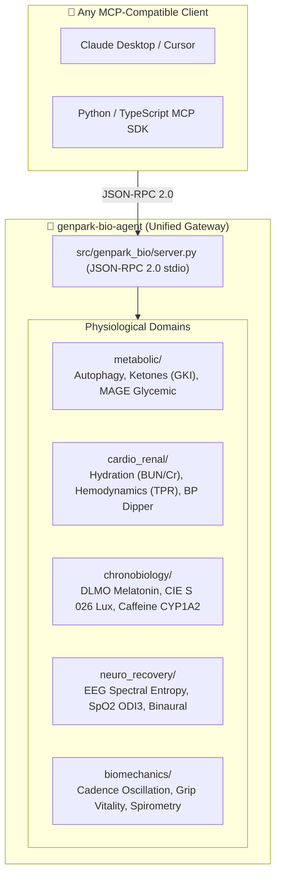

# 🧬 GenPark Bio-Agent

[](https://www.genpark.ai)
[](https://www.linkedin.com/company/92955550)
[](https://modelcontextprotocol.io/)
[](https://python.org)
[](https://opensource.org/licenses/MIT)

> **Industrial-grade Model Context Protocol (MCP) Suite for Personal Longevity, Metabolism, Biomarker Dynamics & Chronobiology.**
> Built with 100% pure Python standard library — **Zero external dependencies (`pip`) required**.

---

## 🌐 Official Channels
- **Official Website**: [https://www.genpark.ai](https://www.genpark.ai)
- **LinkedIn Page**: [https://www.linkedin.com/company/92955550](https://www.linkedin.com/company/92955550)

---

## 🏗️ Architecture & Modules



---

## 🛠️ MCP Tools Exposed

| Tool Name | Domain | Description |
|---|---|---|
| `estimate_autophagy_index` | `metabolic` | Calculate cellular autophagy & mitophagy onset index from fasting duration and exertion. |
| `calculate_gki_score` | `metabolic` | Compute Glucose-Ketone Index (GKI) longevity ratio from glucose (mg/dL) & BHB (mmol/L). |
| `calculate_mage_glucose_dynamics` | `metabolic` | Compute Mean Amplitude of Glycemic Excursions (MAGE) and glycemic variability from CGM. |
| `calculate_bun_creatinine_ratio` | `cardio_renal` | Assess prerenal azotemia vs intrinsic renal strain from serum BUN and creatinine. |
| `compute_cardiac_output_tpr` | `cardio_renal` | Compute stroke volume (mL), cardiac output (L/min), and total peripheral resistance (TPR). |
| `assess_nocturnal_dipping` | `cardio_renal` | Assess nocturnal blood pressure dipping percentage (Normal, Non-dipper, Reverse dipper). |
| `predict_dlmo_clock_time` | `chronobiology` | Predict Dim Light Melatonin Onset (DLMO) clock time based on wake-up time and evening lux. |
| `calculate_equivalent_melanopic_lux` | `chronobiology` | Calculate CIE S 026 Equivalent Melanopic Lux (EML) for circadian lighting entrainment. |
| `calculate_caffeine_clearance` | `chronobiology` | Model CYP1A2 pharmacokinetic caffeine clearance and bedtime adenosine receptor blockade. |
| `compute_eeg_fatigue_entropy` | `neuro_recovery` | Compute frontal Theta/Beta ratio (TBR) and Shannon spectral entropy for cognitive fatigue. |
| `assess_grip_vitality_age` | `biomechanics` | Score isometric grip strength (kg) against normative cohorts to evaluate biological vitality age. |

---

## ⚡ 30-Second Quickstart (Zero pip install required)

Run the built-in quickstart demo immediately with standard Python:
```bash
python quickstart.py
```

### 🔌 Claude Desktop Configuration
Add to your `claude_desktop_config.json`:
```json
{
  "mcpServers": {
    "genpark-bio": {
      "command": "python",
      "args": ["-m", "genpark_bio.server"]
    }
  }
}
```

### 🧪 Self-Test Verification
```bash
python -m genpark_bio.server --test
```

---

## 📄 License
MIT License. Copyright (c) 2026 [GenPark AI](https://www.genpark.ai).
